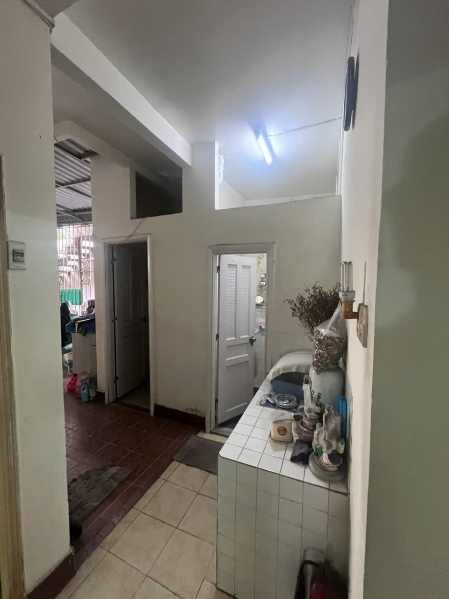
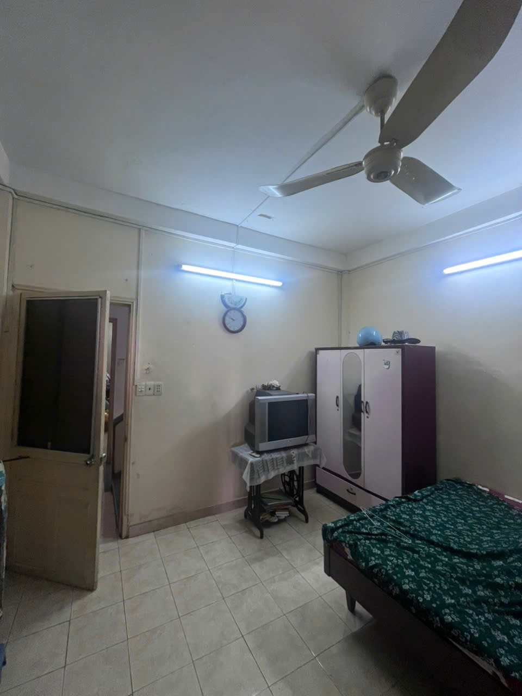
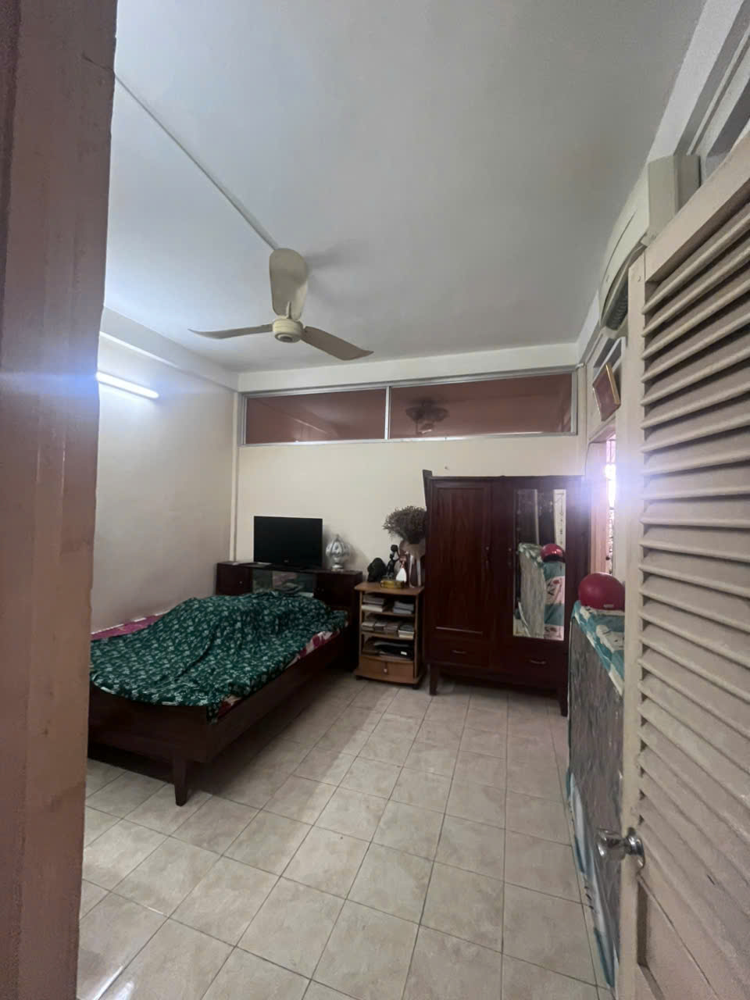
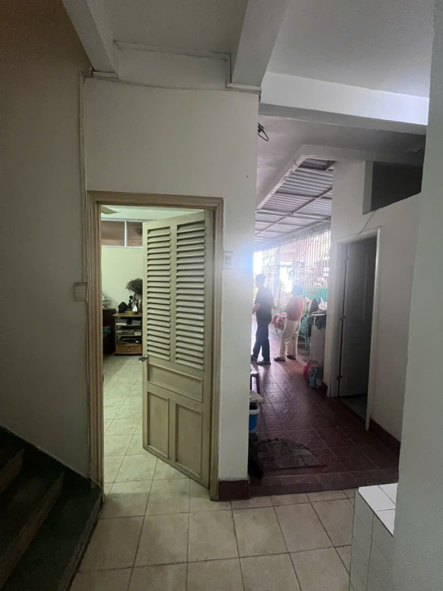
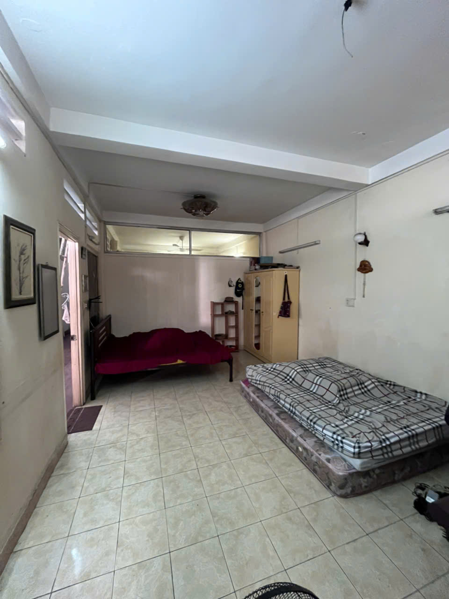

# Hiện trạng Tầng 2 (ảnh chụp ngày 26/11/2026)

> Nhận định ban đầu từ ảnh. Tên phòng là tạm đặt, cần chủ nhà xác nhận và bổ sung kích thước.

| Ảnh | Vị trí (tạm đặt) | Ghi nhận |
|---|---|---|
|  T2-01 | Sảnh cầu thang, nhìn về phía sau | Sàn gạch ceramic kem khoảng 40×40. **Bệ xây ốp gạch trắng** sát tường phải. 2 cửa gỗ panô sơn trắng (một cửa vào WC). **Tường lửng**, phía trên có ô trống tới trần. Hộp điện trên tường trái. Đèn tuýp, đèn compact gắn tường. Phía sau là khu có **mái tôn, sàn gạch đỏ, khung sắt bảo vệ**. Có vệt ố ở chân tường cạnh cửa |
|  T2-02 | Phòng ngủ 1 | Cửa gỗ panô có ô kính. Trần có các đường nối (cần xác nhận là trần tấm hay trần bê tông). Quạt trần, 2 đèn tuýp. **Dây điện đi nổi**. Tường ố bẩn |
|  T2-03 | Phòng ngủ 2 | **Cửa gỗ lá sách**. **Ô kính khung nhôm** phía trên tường ngăn với phòng bên. Máy lạnh treo tường. Quạt trần. Dầm bê tông chạy ngang |
|  T2-04 | Đầu cầu thang | Cầu thang bậc tối màu (lối lên Tầng 3, **phải giữ và bảo vệ**). Cửa lá sách vào phòng ngủ 2. Hành lang ra khu mái tôn phía sau. Dây điện đi nổi |
|  T2-05 | Phòng lớn (phía trước?) | Phòng dài có dầm ngang. **Vách có ô kính phía trên** ngăn với phòng ngủ. Ô thoáng lá sách bên trái. Cửa đi bên trái. Đèn đã tháo, dây treo trên trần |

## Phân nhóm phá dỡ sơ bộ

| Nhóm | Hạng mục |
|---|---|
| **A. Phá ngay** (khi chủ nhà xác nhận) | Toàn bộ cửa gỗ và khung cửa. Ô kính khung nhôm trên vách. Đèn, quạt trần, dây điện và ổ công tắc đi nổi. Máy lạnh (tháo và thu hồi gas, giữ lại nếu tái sử dụng). Bệ xây ốp gạch ở sảnh. Gạch ốp lát và thiết bị WC |
| **B. Chờ kiến trúc sư xác nhận** | Tường ngăn giữa các phòng, tường lửng ở sảnh. Gạch nền và lớp vữa lót (bóc toàn bộ hay lát chồng). Trần (nếu là trần tấm). Khu mái tôn phía sau (có thuộc phạm vi không?) |
| **C. Không đụng** | Cột, dầm, sàn bê tông. Cầu thang. Tường bao và tường giáp nhà kề. Khung sắt bảo vệ (nếu giữ) |

## Cần xác nhận hoặc bổ sung
- [ ] Kích thước mặt bằng Tầng 2 (dài × rộng), chiều cao tầng
- [ ] Số lượng và vị trí WC. Có làm lại WC không?
- [ ] Khu mái tôn, sàn gạch đỏ phía sau có nằm trong phạm vi cải tạo không?
- [ ] Nền: bóc toàn bộ gạch hay lát chồng?
- [ ] Đồ đạc (giường, tủ, tivi) ai dọn, dọn trước ngày nào?
- [ ] Vệt ố chân tường ở T2-01: kiểm tra thấm từ WC
